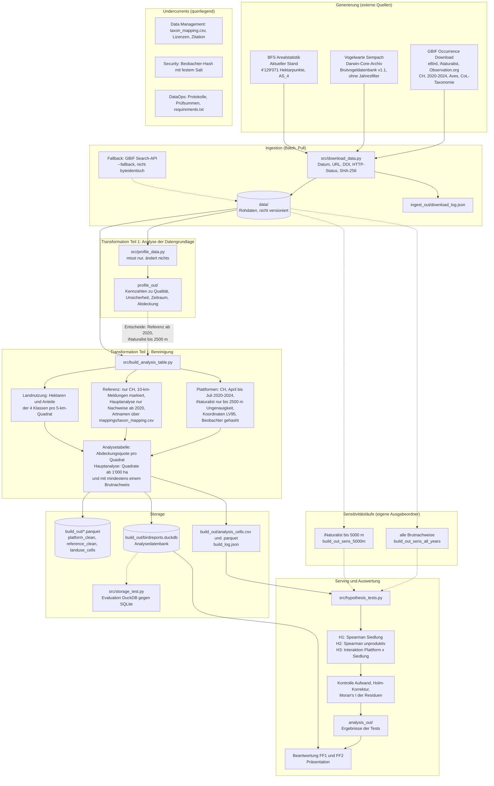

# Birdreports

Projektarbeit im Modul Data Engineering (HS26, ZHAW). Wir untersuchen, wie vollständig Citizen-Science-Plattformen die Brutverbreitung von Vögeln in der Schweiz abbilden, und ob sich die Lücken mit der Landnutzung erklären lassen.

## Gruppe

| Name | ZHAW-Mail |
|---|---|
| Marc Vogelmann | vogmar04@students.zhaw.ch |
| Muriele Stermcnik | stermmur@students.zhaw.ch |
| Alen Rama | ramaale1@students.zhaw.ch |

## Fragestellung

Als Referenz dient die Schweizerische Brutvogeldatenbank der Vogelwarte Sempach mit Brutnachweisen pro Art und 5×5-km-Quadrat. Für jedes Quadrat prüfen wir, ob eBird, iNaturalist und Observation.org die dort brütenden Arten im Zeitraum 2020–2024 während der Brutzeit (April bis Juli) melden. Die Abdeckungsquote eines Quadrats ist der Anteil der Arten mit Brutnachweis, die auf einer Plattform gemeldet sind. Weil die Vogelwarte pro Art und Quadrat nur das letzte Brutjahr führt, zählen in der Hauptanalyse nur Nachweise mit letztem Brutjahr ab 2020; ältere Nachweise lassen offen, ob die Art im Beobachtungszeitraum noch dort brütet. Bei iNaturalist entfallen Meldungen mit einer Koordinatenungenauigkeit über 2'500 m. Beide Setzungen werden in Sensitivitätsläufen variiert (alle Nachweise, 5'000 m).

FF1 (Landnutzung): Hängt die Abdeckungsquote eines Quadrats von seiner Landnutzung ab?

- H1: Je höher der Siedlungsanteil, desto höher die Abdeckungsquote.
- H2: Je höher der Anteil unproduktiver Fläche, desto niedriger die Abdeckungsquote.

FF2 (Plattformen): Unterscheiden sich die Plattformen im Abdeckungsmuster?

- H3: Die Abdeckungsquote von iNaturalist hängt stärker vom Siedlungsanteil ab als die von eBird.

Problemstellung, Methodik, Lebenszyklus und Limitationen sind im separaten Dokument «Projektarbeit Teil 1: Konzeption» ausgeführt.

## Datenquellen

| Quelle | Inhalt | Lizenz |
|---|---|---|
| [EOD – eBird Observation Dataset](https://www.gbif.org/dataset/4fa7b334-ce0d-4e88-aaae-2e0c138d049e), [doi:10.15468/aomfnb](https://doi.org/10.15468/aomfnb) | Beobachtungen, Schweiz, Vögel, 2020–2024 | [CC BY 4.0](https://creativecommons.org/licenses/by/4.0/) |
| [Observation.org, Nature data from around the World](https://www.gbif.org/dataset/8a863029-f435-446a-821e-275f4f641165), [doi:10.15468/5nilie](https://doi.org/10.15468/5nilie) | Beobachtungen mit Anzahl und Uhrzeit | [CC BY-NC 4.0](https://creativecommons.org/licenses/by-nc/4.0/) |
| [iNaturalist Research-grade Observations](https://www.gbif.org/dataset/50c9509d-22c7-4a22-a47d-8c48425ef4a7), [doi:10.15468/ab3s5x](https://doi.org/10.15468/ab3s5x) | Foto-Belege, Medianungenauigkeit 18 m | Datensatz [CC BY-NC 4.0](https://creativecommons.org/licenses/by-nc/4.0/), einzelne Meldungen CC0 oder CC BY |
| [Swiss National Breeding Bird Databank](https://www.gbif.org/dataset/63f077c9-96a0-49de-b3ea-2aa565ee1098), Version 1.1, [doi:10.15468/jujcgr](https://doi.org/10.15468/jujcgr) | Letztes Brutjahr pro Art und 5×5-km-Quadrat | [CC BY 4.0](https://creativecommons.org/licenses/by/4.0/) |
| Arealstatistik des BFS, «Aktueller Stand» ([Erhebung](https://www.bfs.admin.ch/bfs/de/home/statistiken/raum-umwelt/erhebungen/area.html), [Datensatz](https://opendata.swiss/de/dataset/arealstatistik-schweiz)) | Landnutzung pro Hektare, Erhebungsjahre 2013–2020 | Quellenangabe erforderlich, kommerzielle Nutzung nur mit Zustimmung |

Die Lizenzangabe für iNaturalist steht auf Datensatzebene; in unserem Auszug verteilen sich die 66'117 Meldungen auf 53'544 unter CC BY-NC 4.0, 11'133 unter CC BY 4.0 und 1'440 unter CC0 1.0. Observation.org und die nichtkommerziell lizenzierten iNaturalist-Meldungen schliessen eine spätere kommerzielle Weiterverwendung aus; für die Studienarbeit ist die Nutzung gedeckt.

### Zitation

- Wechsler, S., Volet, B. & Schmid, H. (2023). *Swiss National Breeding Bird Databank*. Version 1.1. Swiss Ornithological Institute. <https://doi.org/10.15468/jujcgr>
- GBIF.org (13. Oktober 2026). *GBIF Occurrence Download*. <https://doi.org/10.15468/dl.9qfxn7> (Download-Key `0024005-260928105237408`)
- Bundesamt für Statistik. *Arealstatistik Schweiz* (Standardnomenklatur NOAS04). <https://www.bfs.admin.ch/bfs/de/home/statistiken/raum-umwelt/erhebungen/area.html> (Abgerufen: 13.10.26)

## Daten beschaffen

Die Rohdaten liegen wegen ihrer Grösse und des GitHub-Limits von 100 MB pro Datei nicht im Repository. Sie gehören lokal nach `data/` und werden mit `src/download_data.py` bezogen:

```
python src/download_data.py
```

Das Skript lädt alle drei Quellen, entpackt die Archive und schreibt Datum, Quell-URL, DOI, HTTP-Status, Grösse und SHA-256-Prüfsumme nach `ingest_out/download_log.json`. Vorhandene Dateien bleiben unangetastet, `--force` lädt neu, `--only` beschränkt auf eine Quelle. Das Darwin-Core-Archiv der Vogelwarte ist dadurch verifizierbar: Ein erneuter Bezug ergibt dieselbe Prüfsumme wie die vorliegende Kopie.

GBIF hält erzeugte Downloads nicht unbegrenzt vor. Fällt der Download weg, bezieht `--fallback` dieselben Filter über die Search-API, aufgeteilt nach Datensatz, Jahr und Monat, weil eine einzelne Abfrage höchstens 100'000 Treffer liefert. Diese Variante ist nicht byteidentisch, da die Suche auf der GBIF-Backbone-Taxonomie beruht und der Download auf dem Catalogue of Life; der Lauf wird im Protokoll entsprechend vermerkt.

Inhaltlich beziehen sich die drei Quellen auf:

1. Plattformdaten: GBIF-Download mit den Filtern Country = Switzerland, Year 2020–2024, Scientific name = Aves, Occurrence status = Present und taxonomischer Referenz Catalogue of Life. Der Export enthält neben den drei Plattform-Datensätzen 87'741 Zeilen der Vogelwarte-Datenbank, die wegen der Jahresfilterung nur Brutjahre ab 2020 abdecken und als Referenz ungeeignet sind, sowie 94 Zeilen aus drei weiteren Datensätzen. Verwendet werden ausschliesslich die drei Dataset-Keys aus der Tabelle oben. Ablage: `data/0024005-260928105237408.csv`, trotz Endung tabulatorgetrennt.
2. Referenz: Darwin-Core-Archiv der Brutvogeldatenbank direkt von der Vogelwarte, ohne Jahresfilter. Der Bezug über GBIF mit Jahresfilter wäre ungeeignet, weil `year` dort das letzte Brutjahr bezeichnet. Ablage: `data/dwca-soi_aves-v1/` mit `occurrence.txt`, `meta.xml` und `eml.xml`. Das Archiv umfasst 135'310 Datensätze, davon 129'240 in der Schweiz.
3. Landnutzung: Arealstatistik «Aktueller Stand» als CSV, Ablage in `data/`.

## Setup

```
python3 -m venv .venv
source .venv/bin/activate
pip install -r requirements.txt
```

## Notebook

Das Notebook `notebooks/birdreports.py` ist das Serving-Artefakt. Es liest die gespeicherten Ergebnisse (`build_out/`, `analysis_out*/`, `profile_out/`, `storage_test_out/`, `ingest_out/`), rechnet die Pipeline nicht neu und braucht die Rohdaten nicht.

```
marimo edit notebooks/birdreports.py    # interaktiv
marimo run  notebooks/birdreports.py    # nur lesen
```

## Struktur

```
birdreports/
├── README.md
├── requirements.txt
├── .gitignore
├── docs/
│   └── lueckenanalyse-teil1.md  # Abgleich mit Bewertungsraster und Vorlesung
├── notebooks/
│   └── birdreports.py           # marimo-Notebook: Konzeption, Lebenszyklus, Ergebnisse, Antworten
├── src/
│   ├── download_data.py         # Bezug der drei Rohquellen mit Protokoll
│   ├── storage_test.py          # Storage-Evaluation DuckDB gegen SQLite
│   ├── profile_data.py          # initiale Analyse der Datengrundlage (misst nur)
│   ├── build_analysis_table.py  # Bereinigung und Analysetabelle pro Quadrat
│   └── hypothesis_tests.py      # Hypothesentests H1 bis H3
├── mappings/
│   └── taxon_mapping.csv        # Artnamen Vogelwarte gegen Catalogue of Life
├── ingest_out/                  # Protokoll der Downloads (Datum, URL, DOI, Prüfsumme)
├── build_out/                   # bereinigte Tabellen, Analysetabelle, Analysedatenbank (Hauptanalyse)
├── analysis_out/                # Ergebnisse der Hypothesentests (Hauptanalyse)
├── build_out_sens_*/            # Sensitivitätsläufe: alle Nachweise, iNaturalist bis 5'000 m
├── analysis_out_sens_*/         # Testergebnisse der Sensitivitätsläufe
└── data/                        # lokal, nicht versioniert
```

## Datenfluss

Der Fluss folgt dem Data-Engineering-Lebenszyklus (Generierung, Ingestion, Storage, Transformation, Serving). Die Kästen nennen die ausführenden Skripte, die Ablagen und die wichtigsten Regeln.



## Pipeline

```
python src/download_data.py
python src/profile_data.py         LANDUSE.csv PLATFORM.csv VOGELWARTE/occurrence.txt mappings/taxon_mapping.csv
python src/build_analysis_table.py LANDUSE.csv PLATFORM.csv VOGELWARTE/occurrence.txt mappings/taxon_mapping.csv
python src/hypothesis_tests.py     build_out/analysis_cells.parquet
```

Die Hauptanalyse verwendet Nachweise ab 2020 (`--min-breeding-year 2020`) und iNaturalist-Meldungen bis 2'500 m Ungenauigkeit (`--max-uncertainty 2500`); beides sind die Standardwerte. Die beiden Sensitivitätsläufe schreiben in eigene Ordner und lassen die Hauptanalyse unberührt:

```
python src/build_analysis_table.py LANDUSE.csv PLATFORM.csv VOGELWARTE/occurrence.txt mappings/taxon_mapping.csv build_out_sens_all_years --min-breeding-year 0
python src/hypothesis_tests.py     build_out_sens_all_years/analysis_cells.parquet analysis_out_sens_all_years

python src/build_analysis_table.py LANDUSE.csv PLATFORM.csv VOGELWARTE/occurrence.txt mappings/taxon_mapping.csv build_out_sens_5000m --max-uncertainty 5000
python src/hypothesis_tests.py     build_out_sens_5000m/analysis_cells.parquet analysis_out_sens_5000m
```

`build_analysis_table.py` bereinigt die drei Quellen nach den Regeln der Konzeption und schreibt nach `build_out/`:

| Datei | Inhalt |
|---|---|
| `platform_clean.parquet` | 603'123 Meldungen (drei Plattformen, CH, 2020–2024, April–Juli, iNaturalist bis 2'500 m, Beobachter gehasht) |
| `reference_clean.parquet` | 129'240 Art/Quadrat-Paare der Vogelwarte, 213 Arten, 10-km-Meldungen markiert; die Hauptanalyse nutzt davon 86'530 (letztes Brutjahr ab 2020, ohne 10-km-Meldungen) |
| `landuse_cells.parquet` | 1'839 Quadrate mit Hektaren und Anteilen der vier AS_4-Klassen |
| `analysis_cells.csv/.parquet` | Analysetabelle, eine Zeile pro Quadrat (1'839, davon 1'614 in der Hauptanalyse) |
| `birdreports.duckdb` | Analysedatenbank mit allen vier Tabellen (18,9 MB) |
| `build_log.json` | Parameter, Eingabepfade und Zeilenzahlen des Laufs |

Die Beobachterkennung wird mit einem festen Salt gehasht (BLAKE2s, 8 Byte), bevor irgendetwas geschrieben wird; `recordedBy` verlässt das Skript nicht im Klartext.

Bezeichner und Spaltennamen sind im gesamten Repository englisch, Kommentare, Docstrings und Konsolenausgaben deutsch. Die vier Landnutzungsklassen heissen `settlement`, `agriculture`, `wooded` und `unproductive` (AS_4 = 1 bis 4), die Abdeckungsquoten `coverage_<plattform>` und `coverage_any`.

## Lieferumfang Teil 1 und Stand

- [x] Konzeption: Problemstellung, Forschungsfragen, Methoden, Lebenszyklus
- [x] Ingestion: Plattformdaten (GBIF) und Referenz (Vogelwarte) heruntergeladen
- [x] Ingestion: Arealstatistik (Variablenbeschreibung geprüft, 4'129'071 Hektaren)
- [x] Storage: Evaluation und Wahl der Speicherumgebung (DuckDB mit Parquet)
- [x] Transformation Teil 1: initiale Analyse (`profile_data.py`) und Bereinigung (`build_analysis_table.py`)
- [x] Hypothesentests H1 bis H3 (`hypothesis_tests.py`)
- [x] Download-Skript mit DOI, Datum und Prüfsumme im Protokoll (`download_data.py`)
- [ ] Beantwortung der Forschungsfragen im Notebook, mit Quellenangaben
- [x] Sensitivitätsläufe zu Referenzalter und iNaturalist-Schwelle (`build_out_sens_*`, `analysis_out_sens_*`)
- [ ] Weitere Sensitivitätsanalysen (10-km-Meldungen, Brutzeitgrenzen, Randquadrate)
- [ ] Tests für die Transformationsschritte
- [ ] Präsentation

Die Lücken gegenüber dem Bewertungsraster sind in [docs/lueckenanalyse-teil1.md](docs/lueckenanalyse-teil1.md) dokumentiert.

## Ergebnisse der Hypothesentests

Grundlage ist die Hauptanalyse mit Nachweisen ab 2020 und iNaturalist-Meldungen bis 2'500 m Ungenauigkeit (die Parameter stehen im `build_log.json`). Sie umfasst 1'614 Quadrate, also ohne Randquadrate unter 1'000 ha und ohne Quadrate ohne Brutnachweis, mit insgesamt 86'530 Art/Quadrat-Paaren. Die mittlere Abdeckungsquote je Quadrat beträgt 37,2 % für eBird, 5,2 % für iNaturalist, 5,5 % für Observation.org und 39,9 % für alle drei Plattformen zusammen.

| Hypothese | Test | Effektstärke [95 %-KI] | p (Holm) | Ergebnis |
|---|---|---|---|---|
| H1 Siedlung ↑ → Abdeckung ↑ | Spearman | rho = 0,338 [0,292; 0,383] | 4,7e-44 | gestützt |
| H2 unproduktiv ↑ → Abdeckung ↓ | Spearman | rho = −0,001 [−0,053; 0,051] | 0,974 | nicht gestützt |
| H3 iNaturalist hängt stärker von Siedlung ab als eBird | Interaktionsterm | +0,235 [0,151; 0,319] | 7,2e-08 | gestützt |

Die Kontrolle des Beobachtungsaufwands verändert das Bild erheblich. Die Zahl der Meldungen je Quadrat korreliert zu rho = 0,934 mit der Abdeckungsquote, und das R² steigt von 0,126 im Modell mit Landnutzung allein auf 0,856, sobald der Aufwand hinzukommt. Der Koeffizient des Siedlungsanteils fällt dabei von +1,20 auf −0,059 [−0,133; 0,015] und ist nicht mehr von null verschieden. Die Landnutzung wirkt also überwiegend über den Aufwand. Modell 2 widerlegt H1 damit nicht, sondern weist den Aufwand als Mediator aus; berichtet werden beide Modelle.

H2 bleibt auch ohne Aufwandskontrolle ohne Zusammenhang. Unter Kontrolle des Aufwands ist die Abdeckung in Quadraten mit mehr unproduktiver Fläche leicht höher (+0,130 [0,096; 0,164]). Das ist das Gegenteil der Hypothese; eine mögliche Erklärung ist, dass dort weniger Arten brüten und die wenigen vorkommenden Arten eher erfasst werden. Das haben wir nicht geprüft.

Die Steigung des Siedlungsanteils je Plattform, aus getrennten Modellen mit HC3-Standardfehlern: eBird −0,118 [−0,191; −0,045], iNaturalist +0,117 [0,065; 0,169], Observation.org −0,026 [−0,065; 0,013]. Bei gleichem Aufwand nimmt die Abdeckung von eBird mit dem Siedlungsanteil also leicht ab, die von iNaturalist zu.

Moran's I der Residuen von Modell 2 beträgt 0,113 (Permutationstest mit 999 Permutationen, p = 0,001, Rook-Nachbarschaft auf dem 5-km-Raster), das der Abdeckungsquote selbst 0,304. Benachbarte Quadrate sind demnach nicht unabhängig, womit die in der Konzeption angekündigte räumliche Autokorrelation tatsächlich auftritt und die p-Werte entsprechend vorsichtig zu interpretieren sind.

Die Abdeckungsquote ist bei iNaturalist und Observation.org ein Anteil nahe 0, wofür die lineare Regression nur eine Näherung ist. Die Aussagen zu H1 und H2 stützen sich deshalb primär auf Spearman; ein binomiales Modell ist für Teil 2 vorgesehen.

### Sensitivität

Die zwei Sensitivitätsläufe verändern je eine Setzung der Hauptanalyse (siehe Pipeline).

| | Hauptanalyse (ab 2020, 2'500 m) | alle Nachweise | iNaturalist bis 5'000 m |
|---|---|---|---|
| Quadrate / Referenzpaare | 1'614 / 86'530 | 1'637 / 127'269 | 1'614 / 86'530 |
| mittlere Abdeckung, alle Plattformen | 39,9 % | 32,6 % | 39,9 % |
| H1 Spearman rho [KI] | 0,338 [0,292; 0,383] | 0,368 [0,322; 0,411] | 0,339 [0,292; 0,384] |
| H2 Spearman rho [KI] | −0,001 [−0,053; 0,051] | −0,042 [−0,093; 0,009] | −0,001 [−0,053; 0,051] |
| H3 Interaktion [KI] | +0,235 [0,151; 0,319] | +0,204 [0,141; 0,268] | +0,236 [0,152; 0,319] |
| Siedlung in Modell 2 [KI] | −0,059 [−0,133; 0,015] | −0,044 [−0,098; 0,010] | −0,058 [−0,132; 0,017] |
| Moran's I der Residuen | 0,113 | 0,160 | 0,113 |

Die Aussagen zu H1, H2 und H3 sind in allen drei Läufen gleich: H1 und H3 gestützt, H2 nicht gestützt, der Siedlungsanteil in Modell 2 nicht von null verschieden. Die Schwelle für iNaturalist (2'500 gegen 5'000 m) ändert die Ergebnisse praktisch nicht. Das Referenzalter verschiebt vor allem das Niveau der Abdeckung (32,6 gegen 39,9 %), weil ältere Nachweise häufiger als Lücke erscheinen, und etwas die Effektstärken, ohne eine Schlussfolgerung zu kippen.

## Storage

Die Analysedatenbank ist DuckDB, die bereinigten Rohdaten liegen als Parquet vor. `src/storage_test.py` vergleicht DuckDB mit SQLite auf den Projektdaten; es handelt sich um eine Einzelmessung auf einem Rechner.

| | DuckDB | SQLite |
|---|---|---|
| Laden Arealstatistik (4,1 Mio. Zeilen) | 0,26 s | 2,89 s |
| Laden Plattformdaten (1,6 Mio. Zeilen) | 2,29 s | 4,24 s |
| Aggregation auf 5-km-Quadrate | 0,01 s | 1,13 s |
| Zählung nach Datensatz, Jahr und Monat | 0,01 s | 1,01 s |
| Dateigrösse der Datenbank | 46,7 MB | 272,9 MB |

Die Plattformdaten umfassen als Parquet mit neun Spalten 26,5 MB. PostgreSQL mit PostGIS haben wir nicht gemessen, weil es einen Server voraussetzt und räumliche Funktionen entbehrlich sind: Die Quadrate werden aus den LV95-Koordinaten gerechnet.

## Hinweise zu den Daten

- Die Brutvogeldatenbank führt pro Art und Quadrat nur das letzte Brutjahr und stützt sich vor allem auf validierte Meldungen von [ornitho.ch](https://www.ornitho.ch) sowie auf Monitoringprogramme. Sie ist keine unabhängige Erhebung.
- Die Artnamen der Referenz weichen bei 17 von 213 Arten von denen der Plattformdaten ab, überwiegend wegen Gattungsumbenennungen. Für 16 dieser Arten existiert ein Gegenname in den Plattformdaten; für *Ficedula parva* liegt im Zeitraum keine Meldung vor. Die Zuordnung ist in [`mappings/taxon_mapping.csv`](mappings/taxon_mapping.csv) mit Begründung je Zeile festgehalten.
- Beobachterkennungen werden vor dem Speichern gehasht; Klarnamen liegen nicht im Repository.
